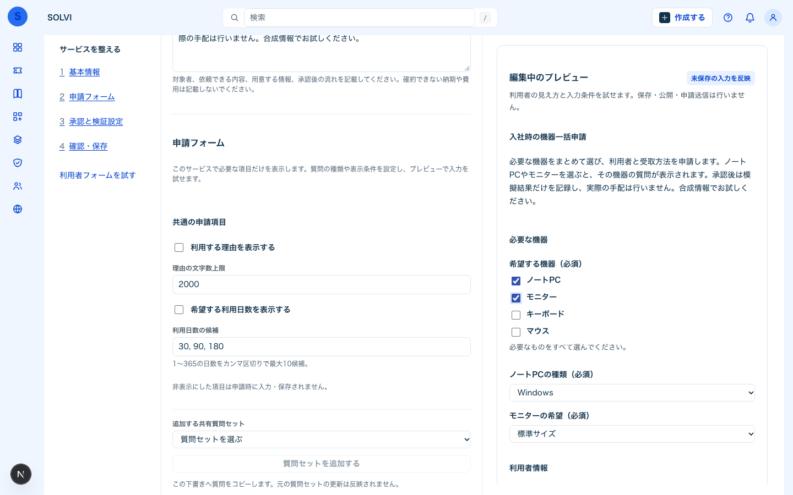

# WP-P2-UIX-042 検証記録

2026-11-11（日本時間）。基点`5c196fd`、branch`wp/WP-P2-UIX-042`。

サービスごとの「利用する理由」「希望する利用日数」の表示切替、複数アイテムのチェックボックス選択、回答に応じた後続質問を実装した。カタログ作成の「申請フォーム → 共通の申請項目」で切り替える。「入社時の機器一括申請」「セキュリティ例外の申請」の新テンプレートから設定例を試せる。既存サービスは自動変更しない。

## 互換性と検証対象

- `requestFields`省略は従来どおり両項目を表示・必須。OFFはAPIでも必須判定せず、余分なOFF値を新snapshotから除去する。空文字や仮の日数で補わない。
- `visibleWhen.contains`は複数選択の既知候補に限定する。select/checkboxの従来のequals、条件の循環拒否、非表示の子孫の必須判定・値除去を維持する。未保存の空白付き候補も保存時と同じ解釈をする。
- 保存・複製・共有質問の参照変換、プレビュー、申請、復元、申請内容の変更、詳細・承認履歴・チケット・模擬結果で同じ契約を使う。質問の種類を変えた際の条件の型不一致は表示し、意図した回答を選び直して修正できる。
- 既存snapshot/hash/承認は補完更新しない。再送と改訂は申請時の固定定義で判定する。
- DDL・Migration・依存追加なし。認証・認可・RLS・監査event・Executor境界の変更なし。新形式readerを残した前方互換rollbackとする。

## 結果

| 検証 | 結果 |
|---|---|
| 関連unit | 19files / 683件成功 |
| 全体unit | 4,271件成功、既存34件失敗と収集エラー1file。041と失敗名が一致、新規失敗0 |
| workspace型検査 / ESLint | 成功 |
| 追加・変更テストのstrict TypeScript | 7files、成功 |
| Prettier / check:all | 成功 |
| production build | `NODE_ENV=production`を明示して成功 |
| 実API / PostgreSQL | 10項目成功（[api-smoke.json](api-smoke.json)） |
| Chrome157 / WebKit26.5 | 各9シナリオ成功、axe各9回・違反0、1440/375px・キーボード確認 |

全体unitの既存失敗はナレッジの欠落fixture/旧UI期待値と、性能比較の固定source/commit不足。テストの削除・skipは行っていない。[unit-summary.json](unit-summary.json)に失敗名と基点比較を記録した。この全体Gateは未達としてWPをreviewに保つ。

## 実行コマンド

- `rtk proxy npx vitest run tests/unit/catalog-*.test.ts tests/unit/portal-catalog.test.ts tests/unit/user-directory.test.ts tests/unit/auth-role-clock.test.ts --reporter=json --outputFile=.local/fix-042/related.json`
- `rtk npm run test:unit -- --reporter=json --outputFile=.local/fix-042/unit.json`
- `rtk npm run typecheck`、`rtk npm run lint`、`rtk npm run check:all`
- `rtk proxy npx tsc --noEmit --strict --target ES2023 --module ESNext --moduleResolution bundler --lib ES2023,DOM,DOM.Iterable --jsx react-jsx --esModuleInterop --skipLibCheck apps/web/next-env.d.ts`に変更テスト7filesを渡して実行
- `rtk proxy env NODE_ENV=production npm run build`（Node24のPATH、開発Web/APIを停止して実施、完了後に再起動）
- `rtk proxy node --env-file=.env tools/smoke_catalog_flexible.mjs`
- `rtk proxy node tools/ui_catalog_flexible_check.mjs`（`SOLVI_UI_BROWSER=webkit`でも実施。資格情報は非出力env）

詳細ログ・生unit JSONはGit管理外`.local/fix-042/`。最初のbuildはツール環境の`NODE_ENV=development`が引き継がれて失敗したため、本番設定を明示し、生成物を消して再実行した。製品コードを変更して回避していない。

## 操作・画像と再現性

実APIの合成サービス1件・申請2件を使い、終了後サービスを非公開にした。ブラウザは各engineで合成サービス保存・公開・申請・改訂を各1回だけ実施し、既存業務サービスは変更していない。Chromeの履歴hash検証スクリプト補正とWebKitのナビゲーション遷移完了後の撮影は、記録済みIDを読取照合してから再開した。業務操作の再送・重複作成なし。

[ブラウザ記録と画像一覧](browser/README.md)。確認用の未保存フォーム画像は以下。

Safari/Edge製品そのものの実機確認は未実施。WebKitでの確認をSafari製品実機の確認として扱わない。041の人間securityレビュー待ちは継続し、mainへのpushは行わない。
